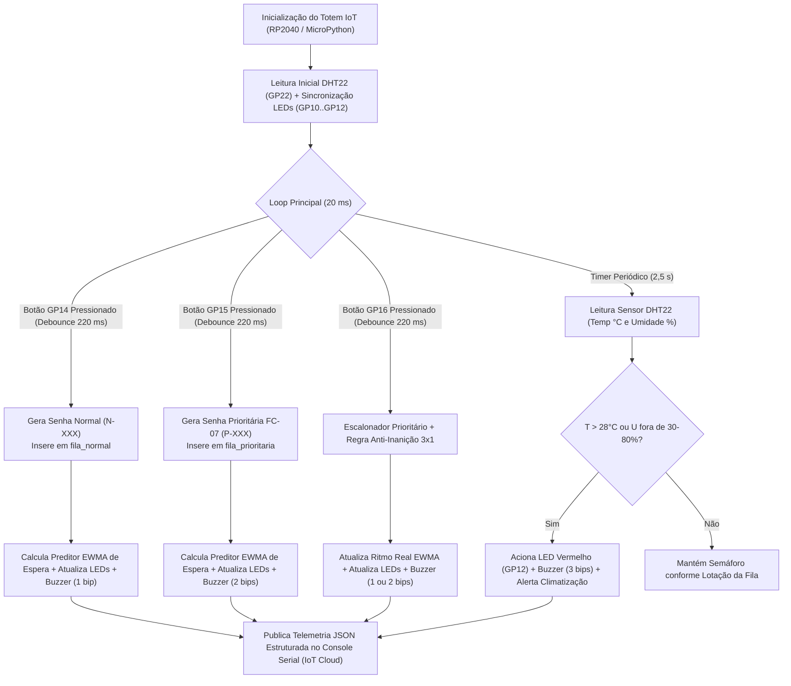

# Totem Inteligente de Fila Virtual, Acessibilidade e Monitoramento Ambiental — Central do Cidadão de Aurora (`Citizen Assist AI`)

**Disciplina:** Computer Organization and Architecture (COA) — Physical Computing: IoT & IoB  
**Professor:** Prof. Dr. Marcus Grilo  
**Curso:** Ciência da Computação (1º Ano — Turma 1CC) — FIAP | **Global Solution 2026.2 (`CitizenTech`)**  
**Plataforma de Simulação:** Wokwi (`Raspberry Pi Pico` + `MicroPython`)

**Integrantes do Grupo (Turma 1CCPZ — 1º Ano de Ciência da Computação — FIAP):**
- **Luiz Otávio Brito Freixo** — RM: `569977`
- **Ana Beatriz Berbel Marini** — RM: `574876`


---

## Sumário Executivo e Alinhamento com os ODS (ONU)

Este módulo implementa a camada de **Computação Física e Internet das Coisas (IoT)** do ecossistema unificado **Citizen Assist AI — Central do Cidadão de Aurora**. O projeto une a sugestão central da Global Solution (*"sistema de fila virtual para postos de atendimento ao cidadão, registrando entrada e saída de pessoas por botões e estimando tempo de espera"*) aos requisitos de **Computer Organization and Architecture** (sensoriamento ambiental com `DHT22`, processamento lógico embarcado em `MicroPython` na `Raspberry Pi Pico` e acionamento de atuadores visuais e sonoros de acessibilidade).

- **ODS 10 (Redução das Desigualdades):** Garantia automatizada de prioridade legal (Ficha `FC-07`: idosos 60+, gestantes, PcD, autistas e pessoas com criança de colo) e sinalização sonora diferenciada em frequência/pulsos para cidadãos com deficiência visual.
- **ODS 11 (Cidades e Comunidades Sustentáveis):** Modernização de espaços públicos de atendimento com transparência de fila em tempo real e monitoramento de salubridade térmica.
- **ODS 16 (Paz, Justiça e Instituições Eficazes):** Previsibilidade no atendimento presencial e eliminação de filas desorganizadas ou inanição (*starvation*) no serviço público.

---

## Etapa 1 — Identificação do Problema

### 1.1. O Problema Urbano e Social Escolhido
Nos postos presenciais de emissão de documentos e serviços públicos municipais (como a **Central do Cidadão de Aurora**, responsável por RG, CPF, Título de Eleitor, CTPS e CNH descritos nas fichas `FC-01` a `FC-07`), ocorrem três problemas críticos e recorrentes:
1. **Imprevisibilidade e Desorganização das Filas:** Cidadãos aguardam sem saber quantas pessoas estão à frente ou qual é o tempo estimado de espera, gerando ansiedade, conflitos nos guichês e desistências.
2. **Barreiras de Acessibilidade e Risco de Inanição (*Starvation*):** Pessoas com direito a atendimento prioritário (Lei Federal nº 10.048/2000 e Ficha `FC-07`) frequentemente enfrentam falhas na triagem manual, enquanto cidadãos com deficiência visual não dispõem de confirmação sonora clara ao retirar senhas ou serem chamados. Por outro lado, em horários de pico, chamar exclusivamente a fila prioritária pode congelar completamente a fila normal.
3. **Desconforto Térmico e Insalubridade em Salões Lotados:** O acúmulo de pessoas em ambientes públicos fechados eleva rapidamente a temperatura ($> 28^\circ\text{C}$) e altera a umidade relativa do ar, afetando diretamente a saúde e o bem-estar de idosos, gestantes e servidores públicos.

### 1.2. Público Afetado
- **Cidadãos em geral** que buscam atendimento presencial para emissão de documentos essenciais (`FC-01` a `FC-06`);
- **Público prioritário e vulnerável (`FC-07`):** idosos (60+ anos), gestantes, lactantes, pessoas com deficiência (visual, auditiva ou motora), pessoas com transtorno do espectro autista (TEA) e pessoas com criança de colo;
- **Atendentes e gestores públicos** da Central do Cidadão de Aurora, que carecem de telemetria em tempo real sobre lotação e condições térmicas do salão.

### 1.3. Justificativa da Solução Tecnológica (IoT + Computação Física)
Um **Totem IoT embarcado baseado na `Raspberry Pi Pico`** resolve o problema na ponta (*Edge Computing*): captura eventos físicos de entrada e chamada por botões com tratamento de ruído (*debounce*), mede continuamente temperatura e umidade via sensor digital `DHT22`, calcula a previsão de espera por algoritmo adaptativo, aciona sinalizadores luminosos (semáforo de LEDs) e sonoros (Buzzer PWM acessível) e publica telemetria JSON estruturada para o painel do **Citizen Assist AI**, permitindo que o cidadão consulte a lotação antes mesmo de sair de casa.

---

## Etapa 2 — Planejamento da Solução, Sensores e Atuadores

### 2.1. Arquitetura de Hardware e Pinagem na `Raspberry Pi Pico`


| Componente no Wokwi | ID no `diagram.json` | Pino `Raspberry Pi Pico` | Tipo de Interface | Função no Totem da Central de Aurora |
|---|---|---|---|---|
| **Placa Microcontroladora** | `pico` | `GP0` / `GP1` (UART0) | Serial Monitor | Processamento central RP2040 (`MicroPython`) e publicação de telemetria JSON |
| **Botão Verde (`Pushbutton`)** | `btn_normal` | `GP14` (`IN, PULL_UP`) | Entrada Digital (Ativo Baixo `GND`) | Emissão de nova senha para a **Fila Normal** (`N-001`, `N-002`...) |
| **Botão Azul (`Pushbutton`)** | `btn_prio` | `GP15` (`IN, PULL_UP`) | Entrada Digital (Ativo Baixo `GND`) | Emissão de nova senha para a **Fila Prioritária Legal `FC-07`** (`P-001`, `P-002`...) |
| **Botão Amarelo (`Pushbutton`)** | `btn_chamar` | `GP16` (`IN, PULL_UP`) | Entrada Digital (Ativo Baixo `GND`) | Acionamento do **Guichê de Atendimento** para chamar o próximo cidadão (Saída) |
| **Sensor Ambiental `DHT22`** | `dht1` | `GP22` (`VCC=3V3`, `GND`) | Barramento Digital *Single-Wire* | Medição periódica de **Temperatura ($^\circ\text{C}$)** e **Umidade Relativa ($\%$)** do salão |
| **LED Verde + Resistor $220\,\Omega$** | `led_verde` / `r_verde` | `GP10` (`OUT`) | Saída Digital | Indica **Fila Livre** ($\le 2$ pessoas) e **Conforto Térmico Ideal** ($\le 26^\circ\text{C}$) |
| **LED Amarelo + Resistor $220\,\Omega$** | `led_amarelo` / `r_amarelo` | `GP11` (`OUT`) | Saída Digital | Indica **Fila Moderada** ($3$ a $5$ pessoas) ou **Atenção Térmica** ($26^\circ\text{C} < T \le 28^\circ\text{C}$) |
| **LED Vermelho + Resistor $220\,\Omega$** | `led_vermelho` / `r_vermelho` | `GP12` (`OUT`) | Saída Digital | Indica **Superlotação** ($\ge 6$ pessoas) ou **Alerta Ambiental Crítico** ($T > 28^\circ\text{C}$ ou umidade fora de $30\%\text{–}80\%$) |
| **Buzzer Passivo / Piezo** | `bz1` | `GP18` (`PWM OUT`) | Saída Modulada em Frequência (`PWM`) | **Acessibilidade Sonora (`FC-07`):** `1 bip` ($880\text{ Hz}$) para fila normal; `2 bips` ($1175\text{ Hz}$) para fila prioritária; `3 bips` ($1568\text{ Hz}$) para alerta ambiental/superlotação |

### 2.2. Planejamento da Lógica em `MicroPython` ([main.py](file:///d:/M%20Drive/Meu%20Drive/FIAP/Global%20Solution%202/wokwi_iot/main.py))



1. **Filtro Digital de *Debounce* por Borda de Descida (`220 ms`):** Como os botões utilizam resistores internos de `PULL_UP` ligados ao `GND`, a pressão gera transição `1 -> 0`. O controlador valida `diff_ms(t_atual, ts_debounce) >= 220` antes de computar o evento, eliminando trepidações mecânicas.
2. **Escalonador Prioritário com Regra Anti-Inanição (`3x1`):**
   - Sempre que há cidadãos em `fila_prioritaria` (`FC-07`), eles têm precedência sobre `fila_normal`.
   - **Prevenção de *Starvation*:** O contador `consecutivos_prio` rastreia quantos prioritários foram chamados em sequência. Ao atingir `3` chamadas prioritárias consecutivas, caso exista cidadão aguardando na `fila_normal`, a próxima chamada atende obrigatoriamente `1` cidadão da fila normal (`ANTI_INANICAO_3X1`) e zera o contador, retomando a prioridade imediatamente a seguir.
3. **Preditor de Tempo de Espera por Média Móvel Ponderada (`EWMA`):**
   - **Fórmula Heurística Base:**
     $$\hat{T}_{\text{base}} = 5\text{ min} \times N_{\text{normal}} + 7\text{ min} \times N_{\text{prio}}$$
   - **Ajuste Dinâmico pelo Ritmo Real dos Guichês:** A cada chamada concluída, o intervalo real medido $t_{\text{medido}}$ atualiza a média móvel exponencialmente ponderada ($\alpha = 0,30$):
     $$\bar{t}_{k} = \alpha \cdot t_{\text{medido}} + (1 - \alpha) \cdot \bar{t}_{k-1}$$
     O tempo estimado final combina $70\%$ da linha de base com $30\%$ do fator de ritmo observado nos guichês ($\hat{T}_{\text{EWMA}} = \hat{T}_{\text{base}} \cdot [0,70 + 0,30 \cdot (\bar{t}_k / 5,5)]$).

---

## Etapa 3 — Construção do Protótipo e Instruções de Execução

### 3.1. Arquivos Entregues neste Módulo (`wokwi_iot/`)
- [main.py](file:///d:/M%20Drive/Meu%20Drive/FIAP/Global%20Solution%202/wokwi_iot/main.py): Firmware completo em `MicroPython` para a `Raspberry Pi Pico`.
- [diagram.json](file:///d:/M%20Drive/Meu%20Drive/FIAP/Global%20Solution%202/wokwi_iot/diagram.json): Circuito completo do Wokwi com `wokwi-pi-pico`, 3 botões (`GP14`, `GP15`, `GP16`), sensor `wokwi-dht22` (`GP22`), 3 LEDs com resistores de $220\,\Omega$ (`GP10`, `GP11`, `GP12`) e `wokwi-buzzer` (`GP18`).
- [simulador_totem_pc.py](file:///d:/M%20Drive/Meu%20Drive/FIAP/Global%20Solution%202/wokwi_iot/simulador_totem_pc.py): Simulador de bancada em Python padrão e suíte automatizada de testes (`--test`) para validação local sem placa física.
- [README_COA_WOKWI.md](file:///d:/M%20Drive/Meu%20Drive/FIAP/Global%20Solution%202/wokwi_iot/README_COA_WOKWI.md): Documentação técnica completa nas 4 etapas da rubrica de COA.

### 3.2. Como Executar no Simulador Wokwi
1. Acesse diretamente o projeto público salvo no Wokwi: [https://wokwi.com/projects/480088937104796673](https://wokwi.com/projects/480088937104796673) *(ou o template oficial `https://wokwi.com/projects/new/micropython-pi-pico`)*
2. Na aba **`main.py`**, cole o conteúdo integral de [main.py](file:///d:/M%20Drive/Meu%20Drive/FIAP/Global%20Solution%202/wokwi_iot/main.py).
3. Na aba **`diagram.json`**, cole o conteúdo integral de [diagram.json](file:///d:/M%20Drive/Meu%20Drive/FIAP/Global%20Solution%202/wokwi_iot/diagram.json).
4. Clique no botão verde **Start the simulation (Play)**:
   - Pressione o **Botão Verde (`GP14`)** para adicionar cidadãos à **Fila Normal** (`1 bip`, LED atualiza conforme lotação).
   - Pressione o **Botão Azul (`GP15`)** para adicionar cidadãos à **Fila Prioritária `FC-07`** (`2 bips`, prioridade legal).
   - Pressione o **Botão Amarelo (`GP16`)** para o guichê chamar o próximo cidadão (observe a prioridade e a regra anti-inanição `3x1` no Console Serial).
   - Clique sobre o sensor **`DHT22` (`GP22`)** durante a simulação e arraste o controle de temperatura para acima de **$28^\circ\text{C}$** (ex.: $29,6^\circ\text{C}$): em até $2,5\text{ s}$ o Totem acende o **LED Vermelho (`GP12`)**, emite **`3 bips` de alerta** no Buzzer (`GP18`) e publica o pacote JSON `"evento": "ALERTA_AMBIENTAL_DHT22"`.

### 3.3. Como Executar e Verificar Localmente no PC (Sem Placa Física)
No terminal, a partir da raiz do repositório:
```bash
python wokwi_iot/simulador_totem_pc.py --test
```
Para utilizar o menu interativo de simulação no terminal:
```bash
python wokwi_iot/simulador_totem_pc.py
```

---

## Etapa 4 — Roteiro de Demonstração para o Vídeo (Divisão Equilibrada: Luiz & Ana)

> **Duração Recomendada:** `2 min 30 s` a `3 min 00 s` (YouTube Não Listado)  
> **Requisito do PDF atendido:** Todos os integrantes participam apresentando o problema, o circuito, a lógica em MicroPython e a alteração ao vivo dos sensores/entradas com a resposta dos atuadores.

| Minutagem | Integrante | Tela Exibida | Fala e Ação de Demonstração |
|---|---|---|---|
| **0:00 – 0:45** | **Ana** | Slide de Contexto / Painel da Central do Cidadão de Aurora | *"Olá, professor Marcus Grilo! Eu sou a Ana e, junto com o Luiz, apresento o módulo de IoT e Computação Física do projeto Citizen Assist AI para a Central do Cidadão de Aurora. O problema urbano que atacamos é a falta de previsibilidade nas filas presenciais de documentos, as barreiras de acessibilidade para idosos e deficientes visuais — protegidos pela ficha FC-07 — e o desconforto térmico em salões públicos lotados. Nossa solução é um Totem Inteligente baseado na Raspberry Pi Pico que integra gestão de fila prioritária, sinalização acessível e monitoramento ambiental em tempo real."* |
| **0:45 – 1:30** | **Luiz** | Aba `diagram.json` e `main.py` no Wokwi | *"Obrigado, Ana! Aqui no Wokwi montamos a arquitetura na Raspberry Pi Pico programada em MicroPython. Nas entradas digitais com pull-up interno temos três botões com filtro de debounce: o botão verde no GP14 para senha normal, o botão azul no GP15 para senha prioritária FC-07 e o botão amarelo no GP16 para o guichê chamar o próximo. No pino GP22 conectamos o sensor digital DHT22 para monitorar temperatura e umidade. Nas saídas, temos o semáforo de LEDs nos pinos GP10, GP11 e GP12 com resistores de 220 ohms e um buzzer PWM no GP18 para acessibilidade sonora."* |
| **1:30 – 2:15** | **Luiz** | Simulação Wokwi rodando ao vivo (Cliques nos botões `GP14`, `GP15`, `GP16`) | *"Iniciando a simulação: o salão está a 24,5 °C e o LED Verde no GP10 indica fila livre. Ao pressionar o botão verde (GP14) duas vezes e o botão azul prioritário (GP15) quatro vezes, o buzzer emite 1 bip para fila normal e 2 bips para prioritária. Veja no Serial Monitor a telemetria JSON: com 3 pessoas o LED Amarelo (GP11) acendeu e, ao chegar a 6 pessoas, o LED Vermelho (GP12) indica superlotação com estimativa de 38 minutos. Agora, pressionando o botão do guichê (GP16), o algoritmo chama primeiro P-001, P-002 e P-003. Na quarta chamada, nossa regra anti-inanição 3 por 1 entra em ação e chama N-001 da fila normal antes de retomar P-004, evitando que a fila normal congele!"* |
| **2:15 – 2:55** | **Ana** | Simulação Wokwi ao vivo (Alterando o slider do `DHT22` no `GP22`) | *"Por fim, vamos demonstrar o monitoramento ambiental no sensor DHT22. Mesmo após a fila esvaziar e o LED voltar ao verde, se o salão aquecer acima de 28 °C — vou subir aqui o DHT22 para 29,6 °C — a Raspberry Pi Pico detecta a anomalia na leitura periódica, aciona imediatamente o LED Vermelho no GP12, emite 3 bips de alerta no buzzer e publica o pacote JSON `ALERTA_AMBIENTAL_DHT22` para acionar a climatização da Central de Aurora. Quando a temperatura retorna a 24 °C, o sistema normaliza automaticamente e volta ao LED Verde. Muito obrigada!"* |

---

## Identificação dos Integrantes e Links de Entrega (Seção 4 e 5 do Enunciado)

- **Integrantes do Grupo (Turma 1CC — FIAP):**
  - **Luiz** *(Responsável pela Frente A: Arquitetura Embarcada MicroPython, Integração IoT e Demonstração de Filas)*
  - **Ana** *(Responsável pela Frente B e Coapresentação: Diagnóstico Urbano, Sensoriamento Ambiental e Demonstração DHT22)*
- **Link do Projeto no Wokwi:** [https://wokwi.com/projects/480088937104796673](https://wokwi.com/projects/480088937104796673)
- **Link do Vídeo Demonstrativo (YouTube Não Listado):** `[Inserir Link do YouTube Não Listado antes do envio no Portal]`
