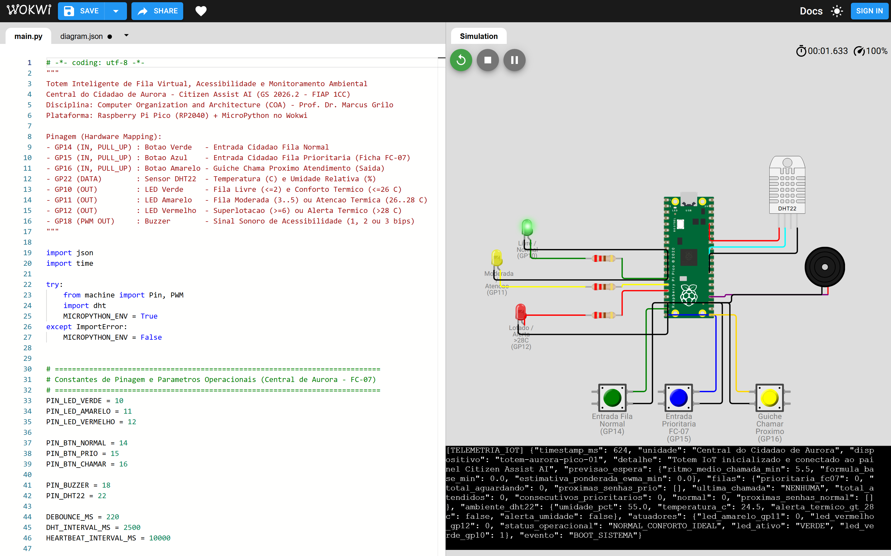
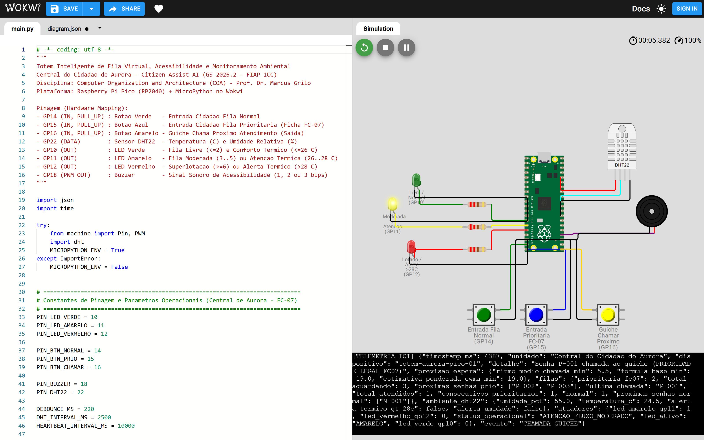
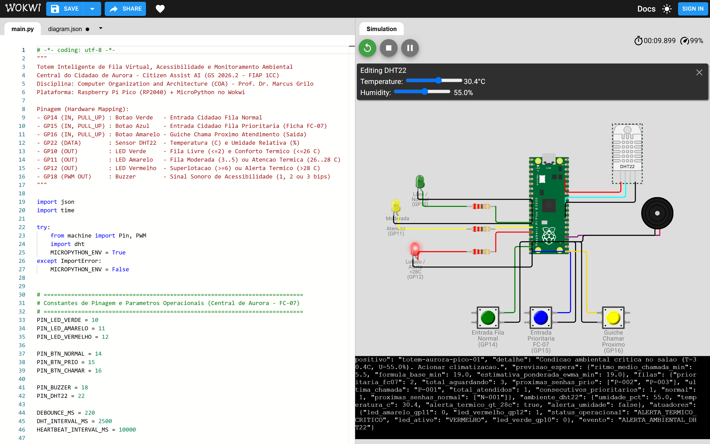

# Totem de Fila Prioritária e Monitoramento Ambiental no Posto de Atendimento

**Disciplina:** Computer Organization and Architecture (Prof. Dr. Marcus Grilo)  
**Atividade:** Global Solution 2026.2 (CitizenTech - Physical Computing: IoT & IoB)  
**Turma:** 1CCPZ - 1º Ano de Ciência da Computação (FIAP)  
**Integrantes:**
- Luiz Otávio Brito Freixo - RM 569977
- Ana Beatriz Berbel Marini - RM 574876

**Link público do projeto no Wokwi:** https://wokwi.com/projects/480088937104796673  
**Relatório em PDF:** [RELATORIO_COA_WOKWI.pdf](../relatorios/RELATORIO_COA_WOKWI.pdf)  
**Arquivos do protótipo:** [main.py](main.py) e [diagram.json](diagram.json)

---

## 1. Identificação do Problema e Público Afetado

Nos postos presenciais de documentos públicos (representados no projeto pela Central do Cidadão de Aurora, com base nas fichas `FC-01` a `FC-07`), quem aguarda atendimento enfrenta três problemas práticos no dia a dia:

1. **Falta de previsão na fila:** o cidadão retira uma senha sem saber quantas pessoas estão na frente nem quanto tempo deve esperar até ser chamado ao guichê.
2. **Prioridade legal e travamento da fila comum:** idosos (60+), gestantes e pessoas com deficiência têm direito a atendimento prioritário (Lei Federal nº 10.048/2000 e ficha `FC-07`). Na triagem manual é comum haver erro na ordem de chamada ou falta de aviso sonoro para pessoas com baixa visão. Ao mesmo tempo, em horários de movimento intenso, chamar apenas senhas prioritárias em sequência faz a fila normal parar por completo.
3. **Calor em salão fechado:** quando o posto enche, a temperatura sobe acima da faixa confortável sem que a administração perceba de imediato para reforçar a ventilação ou o ar-condicionado.

**Quem é afetado:** cidadãos em busca de documentos básicos (RG, CPF, certidões, carteira de trabalho e CNH), em especial o público prioritário da ficha `FC-07`, além dos próprios atendentes do posto.

**Por que usar IoT com Raspberry Pi Pico:** um totem simples montado com a placa Raspberry Pi Pico em MicroPython resolve essa triagem direto no balcão com custo baixo. Ele registra entradas e chamadas por botões físicos, sinaliza a lotação por LEDs, emite bips distintos no buzzer para orientar quem tem deficiência visual, lê temperatura e umidade pelo sensor `DHT22` e envia os dados em JSON pela porta serial.

---

## 2. Planejamento da Solução, Componentes e Lógica do Código

### 2.1. Componentes e Mapeamento de Pinos (Raspberry Pi Pico)

| Componente no Wokwi | ID (`diagram.json`) | Pino na Pico | Configuração | Função no Protótipo |
|---|---|---|---|---|
| Raspberry Pi Pico | `pico` | USB Serial | MicroPython v1.22 | Processa as filas, lê o sensor, controla as saídas e imprime o JSON no monitor serial |
| Botão Verde | `btn_normal` | `GP14` | `Pin.IN, Pin.PULL_UP` | Emite senha da fila normal (`N-001`, `N-002`...) |
| Botão Azul | `btn_prio` | `GP15` | `Pin.IN, Pin.PULL_UP` | Emite senha da fila prioritária `FC-07` (`P-001`, `P-002`...) |
| Botão Amarelo | `btn_chamar` | `GP16` | `Pin.IN, Pin.PULL_UP` | Guichê chama o próximo cidadão da fila |
| Sensor `DHT22` | `dht1` | `GP22` | Digital (3V3 / GND) | Mede temperatura (°C) e umidade relativa (%) a cada 2,5 s |
| LED Verde + resistor 220 $\Omega$ | `led_verde` / `r_verde` | `GP10` | `Pin.OUT` | Aceso com fila livre (até 2 pessoas) e temperatura até 26 °C |
| LED Amarelo + resistor 220 $\Omega$ | `led_amarelo` / `r_amarelo` | `GP11` | `Pin.OUT` | Aceso com fila moderada (3 a 5 pessoas) ou temperatura entre 26 °C e 28 °C |
| LED Vermelho + resistor 220 $\Omega$ | `led_vermelho` / `r_vermelho` | `GP12` | `Pin.OUT` | Aceso com posto cheio (6 ou mais pessoas), temperatura acima de 28 °C ou umidade fora de 30% a 80% |
| Buzzer passivo | `bz1` | `GP18` | `PWM` | 1 bip (880 Hz) para fila normal, 2 bips (1175 Hz) para prioritária e 3 bips (1568 Hz) em alerta |

### 2.2. Como a Placa Recebe, Processa e Responde

O laço principal (`executar_loop_wokwi`) roda a cada `20 ms` na Raspberry Pi Pico e divide o funcionamento em quatro regras diretas na classe `ControladorTotemAurora`:

1. **Leitura dos botões com filtro de *debounce* (`220 ms`):** os três botões fecham contato com o `GND` usando o resistor interno `PULL_UP` da placa (repouso em `1`, pressionado em `0`). Quando detecta a borda de descida (`1 -> 0`), o programa confere se já passaram pelo menos `220 ms` desde o último clique daquele botão, evitando leituras duplicadas por trepidação mecânica.
2. **Fila prioritária com intercalação 3 por 1 (`chamar_proximo_guiche`):** sempre que o guichê aperta o botão amarelo (`GP16`), o código verifica primeiro `fila_prioritaria`. Para impedir que a fila normal congele em dias cheios, o contador `consecutivos_prio` limita a sequência a `3` prioritários seguidos: havendo alguém na `fila_normal`, a 4ª chamada atende `1` senha normal (`ANTI_INANICAO_3X1`), zera o contador e retoma a prioridade logo em seguida.
3. **Estimativa de tempo de espera (`calcular_estimativa_espera`):** parte de um tempo base de `5 min` por pessoa na fila normal e `7 min` na prioritária ($T_{base} = 5 \cdot N_{normal} + 7 \cdot N_{prio}$). A cada chamada do guichê, o intervalo medido atualiza uma média móvel exponencial simples ($\alpha = 0,30$), ajustando 30% da estimativa conforme o ritmo das chamadas. Trata-se de um cálculo estatístico leve adequado ao microcontrolador, sem uso de modelo pesado de aprendizado de máquina.
4. **Monitoramento térmico e saídas físicas (`atualizar_ambiente` e `sincronizar_leds`):** a cada `2,5 s`, a Pico lê o `DHT22` no pino `GP22`. Se a temperatura passar de `28 °C` (ou a umidade sair do intervalo de `30%` a `80%`), o controlador acende o LED Vermelho (`GP12`), dispara `3 bips` agudos no buzzer (`GP18`) e registra o evento `ALERTA_AMBIENTAL_DHT22` no JSON serial. Quando a temperatura volta ao normal, o alerta é desarmado e o LED retorna ao estado correspondente ao tamanho da fila.

**Escopo da comunicação:** no simulador Wokwi, a telemetria em JSON é publicada pela saída serial USB a cada evento e em ciclos de *heartbeat* de `10 s`. Em uma implantação física usando uma Raspberry Pi Pico W (com Wi-Fi integrado), esse mesmo dicionário JSON seria enviado por HTTP ou MQTT para o painel web da Central.

---

## 3. Simulação no Wokwi (Prints Reais de Funcionamento)

### 3.1. Inicialização do Sistema e Estado Normal (LED Verde)
Ao iniciar a simulação no Wokwi (`24,5 °C` e `55%` de umidade, filas vazias), a placa executa a leitura inicial do `DHT22`, acende o **LED Verde (`GP10`)** e imprime o pacote `BOOT_SISTEMA` no monitor serial:



### 3.2. Entrada nas Filas, Semáforo Amarelo e Chamada com Prioridade Legal (`FC-07`)
Após pressionar o botão verde (`GP14`, gerando `N-001`) e três vezes o botão azul (`GP15`, gerando `P-001`, `P-002` e `P-003`), o acionamento do botão amarelo do guichê (`GP16`) chama **`P-001` primeiro** pela regra `PRIORIDADE_LEGAL_FC07`, mantendo `N-001` aguardando. Com 3 pessoas restantes na espera (`19,0 min` estimados), o circuito mantém o **LED Amarelo (`GP11`)** aceso:



### 3.3. Alteração do Sensor `DHT22` Acima de 28 °C e Resposta do Circuito (LED Vermelho + Buzzer)
Clicando sobre o sensor `DHT22` durante a simulação e elevando a temperatura para **`30,4 °C`**, a leitura periódica detecta o calor excessivo no salão, troca a saída para o **LED Vermelho (`GP12`)**, aciona os 3 bips no buzzer (`GP18`) e publica `ALERTA_AMBIENTAL_DHT22` (`ALERTA_TERMICO_CRITICO`) no monitor serial:



---

## 4. Como Executar e Testar o Protótipo

1. **Direto no navegador (Wokwi):** abra https://wokwi.com/projects/480088937104796673 e clique no botão verde **Play** (*Start the simulation*). Use os botões `GP14` (Verde), `GP15` (Azul) e `GP16` (Amarelo) para testar a fila, e clique no sensor `DHT22` (`GP22`) para alterar a temperatura e observar a troca dos LEDs e as mensagens no monitor serial.
2. **Validação local no computador (sem placa física):** na pasta `02_Sistema_Aurora_Cidada`, execute:

```bash
python wokwi_iot/simulador_totem_pc.py --test
```

---

## 5. Código-Fonte em MicroPython (`wokwi_iot/main.py`)

```python
# -*- coding: utf-8 -*-
"""
Totem Inteligente de Fila Virtual, Acessibilidade e Monitoramento Ambiental
Central do Cidadao de Aurora - Citizen Assist AI (GS 2026.2 - FIAP 1CC)
Disciplina: Computer Organization and Architecture (COA) - Prof. Dr. Marcus Grilo
Plataforma: Raspberry Pi Pico (RP2040) + MicroPython no Wokwi

Pinagem (Hardware Mapping):
- GP14 (IN, PULL_UP) : Botao Verde   - Entrada Cidadao Fila Normal
- GP15 (IN, PULL_UP) : Botao Azul    - Entrada Cidadao Fila Prioritaria (Ficha FC-07)
- GP16 (IN, PULL_UP) : Botao Amarelo - Guiche Chama Proximo Atendimento (Saida)
- GP22 (DATA)        : Sensor DHT22  - Temperatura (C) e Umidade Relativa (%)
- GP10 (OUT)         : LED Verde     - Fila Livre (<=2) e Conforto Termico (<=26 C)
- GP11 (OUT)         : LED Amarelo   - Fila Moderada (3..5) ou Atencao Termica (26..28 C)
- GP12 (OUT)         : LED Vermelho  - Superlotacao (>=6) ou Alerta Termico (>28 C)
- GP18 (PWM OUT)     : Buzzer        - Sinal Sonoro de Acessibilidade (1, 2 ou 3 bips)
"""

import json
import time

try:
    from machine import Pin, PWM
    import dht
    MICROPYTHON_ENV = True
except ImportError:
    MICROPYTHON_ENV = False


# ============================================================================
# Constantes de Pinagem e Parametros Operacionais (Central de Aurora - FC-07)
# ============================================================================
PIN_LED_VERDE = 10
PIN_LED_AMARELO = 11
PIN_LED_VERMELHO = 12

PIN_BTN_NORMAL = 14
PIN_BTN_PRIO = 15
PIN_BTN_CHAMAR = 16

PIN_BUZZER = 18
PIN_DHT22 = 22

DEBOUNCE_MS = 220
DHT_INTERVAL_MS = 2500
HEARTBEAT_INTERVAL_MS = 10000

TEMPO_BASE_NORMAL_MIN = 5.0
TEMPO_BASE_PRIO_MIN = 7.0
TEMPO_REFERENCIA_CHAMADA_MIN = 5.5
EWMA_ALPHA = 0.30
MAX_CONSECUTIVOS_PRIO = 3

LIMIAR_TEMP_ATENCAO_C = 26.0
LIMIAR_TEMP_ALERTA_C = 28.0
LIMIAR_UMID_MIN_PCT = 30.0
LIMIAR_UMID_MAX_PCT = 80.0

LIMIAR_FILA_MODERADA = 3
LIMIAR_FILA_LOTADA = 6


# ============================================================================
# Funcoes Utilitarias de Tempo Compativeis com MicroPython e CPython
# ============================================================================
def agora_ms():
    if hasattr(time, "ticks_ms"):
        return time.ticks_ms()
    return int(time.monotonic() * 1000)


def diff_ms(t_atual, t_anterior):
    if hasattr(time, "ticks_diff"):
        return time.ticks_diff(t_atual, t_anterior)
    return t_atual - t_anterior


def aguardar_ms(ms):
    if hasattr(time, "sleep_ms"):
        time.sleep_ms(ms)
    else:
        time.sleep(ms / 1000.0)


# ============================================================================
# Controlador Logico do Totem IoT (Filas, Preditor EWMA e Ambiente)
# ============================================================================
class ControladorTotemAurora:
    """Nucleo de processamento logico do Totem da Central do Cidadao de Aurora."""

    def __init__(self, hardware=None):
        self.hw = hardware
        self.fila_normal = []
        self.fila_prioritaria = []
        self.seq_normal = 0
        self.seq_prioritaria = 0
        self.consecutivos_prio = 0
        self.total_atendidos = 0
        self.ultima_senha_chamada = "NENHUMA"
        self.ultimo_tipo_chamado = "NENHUM"

        # Estado do preditor de espera por media movel ponderada (EWMA)
        self.tempo_medio_medido_min = TEMPO_REFERENCIA_CHAMADA_MIN
        self.ts_ultima_chamada_ms = None

        # Estado ambiental (DHT22)
        self.temperatura_c = 24.5
        self.umidade_pct = 55.0
        self.alerta_ambiental_ativo = False

    def calcular_estimativa_espera(self):
        """
        Calcula o tempo estimado de espera:
        Formula base: T_hat = 5 min * N_normal + 7 min * N_prio
        Ajustada por media movel exponencialmente ponderada (EWMA) do ritmo real de chamadas.
        """
        n_norm = len(self.fila_normal)
        n_prio = len(self.fila_prioritaria)
        tempo_base = (TEMPO_BASE_NORMAL_MIN * n_norm) + (TEMPO_BASE_PRIO_MIN * n_prio)
        if tempo_base == 0:
            return 0.0, 0.0

        fator_ritmo = self.tempo_medio_medido_min / TEMPO_REFERENCIA_CHAMADA_MIN
        if fator_ritmo < 0.5:
            fator_ritmo = 0.5
        elif fator_ritmo > 2.0:
            fator_ritmo = 2.0

        tempo_ponderado = (0.70 * tempo_base) + (0.30 * tempo_base * fator_ritmo)
        return round(tempo_base, 1), round(tempo_ponderado, 1)

    def classificar_status_operacional(self):
        """Define o estado dos LEDs e diagnostico de salubridade/lotacao."""
        total_fila = len(self.fila_normal) + len(self.fila_prioritaria)
        alerta_termico = self.temperatura_c > LIMIAR_TEMP_ALERTA_C
        alerta_umidade = (
            self.umidade_pct < LIMIAR_UMID_MIN_PCT
            or self.umidade_pct > LIMIAR_UMID_MAX_PCT
        )
        superlotado = total_fila >= LIMIAR_FILA_LOTADA

        if superlotado or alerta_termico or alerta_umidade:
            nivel_led = "VERMELHO"
            if alerta_termico:
                status_msg = "ALERTA_TERMICO_CRITICO"
            elif alerta_umidade:
                status_msg = "ALERTA_UMIDADE_FORA_FAIXA"
            else:
                status_msg = "SUPERLOTACAO_POSTO"
        elif total_fila >= LIMIAR_FILA_MODERADA or self.temperatura_c > LIMIAR_TEMP_ATENCAO_C:
            nivel_led = "AMARELO"
            status_msg = "ATENCAO_FLUXO_MODERADO"
        else:
            nivel_led = "VERDE"
            status_msg = "NORMAL_CONFORTO_IDEAL"

        return {
            "nivel_led": nivel_led,
            "status_operacional": status_msg,
            "alerta_termico": alerta_termico,
            "alerta_umidade": alerta_umidade,
            "superlotacao": superlotado,
        }

    def sincronizar_leds(self):
        diag = self.classificar_status_operacional()
        if self.hw:
            self.hw.definir_leds(
                verde=(diag["nivel_led"] == "VERDE"),
                amarelo=(diag["nivel_led"] == "AMARELO"),
                vermelho=(diag["nivel_led"] == "VERMELHO"),
            )
        return diag

    def registrar_entrada_normal(self, ts_ms=None):
        if ts_ms is None:
            ts_ms = agora_ms()
        self.seq_normal += 1
        senha = "N-{:03d}".format(self.seq_normal)
        item = {
            "senha": senha,
            "tipo": "NORMAL",
            "ts_entrada_ms": ts_ms,
        }
        self.fila_normal.append(item)
        diag = self.sincronizar_leds()
        if self.hw:
            if diag["superlotacao"]:
                self.hw.tocar_buzzer(bips=3, freq=1568, duracao_ms=90)
            else:
                self.hw.tocar_buzzer(bips=1, freq=880, duracao_ms=120)
        return self.publicar_telemetria(
            evento="ENTRADA_FILA_NORMAL",
            detalhe="Senha {} emitida (Atendimento Geral)".format(senha),
            ts_ms=ts_ms,
        )

    def registrar_entrada_prioritaria(self, ts_ms=None):
        if ts_ms is None:
            ts_ms = agora_ms()
        self.seq_prioritaria += 1
        senha = "P-{:03d}".format(self.seq_prioritaria)
        item = {
            "senha": senha,
            "tipo": "PRIORITARIA_FC07",
            "ts_entrada_ms": ts_ms,
        }
        self.fila_prioritaria.append(item)
        diag = self.sincronizar_leds()
        if self.hw:
            if diag["superlotacao"]:
                self.hw.tocar_buzzer(bips=3, freq=1568, duracao_ms=90)
            else:
                self.hw.tocar_buzzer(bips=2, freq=1175, duracao_ms=100)
        return self.publicar_telemetria(
            evento="ENTRADA_FILA_PRIORITARIA",
            detalhe="Senha {} emitida (Prioridade Legal FC-07: Idoso/Gestante/PcD)".format(senha),
            ts_ms=ts_ms,
        )

    def chamar_proximo_guiche(self, ts_ms=None, intervalo_simulado_min=None):
        """
        Consome o proximo cidadao da fila aplicando prioridade legal (FC-07)
        combinada com regra anti-inanicao (a cada 3 prioritarios consecutivos,
        intercala 1 atendimento normal se houver cidadao aguardando).
        """
        if ts_ms is None:
            ts_ms = agora_ms()

        if not self.fila_prioritaria and not self.fila_normal:
            self.sincronizar_leds()
            return self.publicar_telemetria(
                evento="GUICHE_FILA_VAZIA",
                detalhe="Nenhum cidadao aguardando na fila no momento",
                ts_ms=ts_ms,
            )

        # Selecao inteligente com protecao contra inanicao da fila normal
        if (
            self.fila_prioritaria
            and (self.consecutivos_prio < MAX_CONSECUTIVOS_PRIO or not self.fila_normal)
        ):
            chamado = self.fila_prioritaria.pop(0)
            self.consecutivos_prio += 1
            regra_acionada = "PRIORIDADE_LEGAL_FC07"
            bips_chamada = 2
            freq_chamada = 1175
        else:
            chamado = self.fila_normal.pop(0)
            regra_acionada = (
                "ANTI_INANICAO_3X1" if self.consecutivos_prio >= MAX_CONSECUTIVOS_PRIO else "ORDEM_NORMAL"
            )
            self.consecutivos_prio = 0
            bips_chamada = 1
            freq_chamada = 880

        # Atualizacao da media movel ponderada (EWMA) do ritmo de atendimento
        if intervalo_simulado_min is not None:
            intervalo_min = float(intervalo_simulado_min)
        elif self.ts_ultima_chamada_ms is not None:
            decorrido_s = max(1.0, diff_ms(ts_ms, self.ts_ultima_chamada_ms) / 1000.0)
            # Em simulacao interativa onde cliques ocorrem em segundos, converte escala
            intervalo_min = decorrido_s if decorrido_s >= 1.5 else TEMPO_REFERENCIA_CHAMADA_MIN
            if intervalo_min > 12.0:
                intervalo_min = 6.0
        else:
            intervalo_min = TEMPO_REFERENCIA_CHAMADA_MIN

        self.tempo_medio_medido_min = round(
            (EWMA_ALPHA * intervalo_min) + ((1.0 - EWMA_ALPHA) * self.tempo_medio_medido_min),
            2,
        )
        self.ts_ultima_chamada_ms = ts_ms
        self.total_atendidos += 1
        self.ultima_senha_chamada = chamado["senha"]
        self.ultimo_tipo_chamado = chamado["tipo"]

        self.sincronizar_leds()
        if self.hw:
            self.hw.tocar_buzzer(bips=bips_chamada, freq=freq_chamada, duracao_ms=110)

        return self.publicar_telemetria(
            evento="CHAMADA_GUICHE",
            detalhe="Senha {} chamada ao guiche ({})".format(chamado["senha"], regra_acionada),
            ts_ms=ts_ms,
        )

    def atualizar_ambiente(self, temperatura_c, umidade_pct, ts_ms=None):
        if ts_ms is None:
            ts_ms = agora_ms()
        self.temperatura_c = round(float(temperatura_c), 1)
        self.umidade_pct = round(float(umidade_pct), 1)
        diag = self.sincronizar_leds()

        alerta_agora = diag["alerta_termico"] or diag["alerta_umidade"]
        if alerta_agora and not self.alerta_ambiental_ativo:
            self.alerta_ambiental_ativo = True
            if self.hw:
                self.hw.tocar_buzzer(bips=3, freq=1568, duracao_ms=90)
            return self.publicar_telemetria(
                evento="ALERTA_AMBIENTAL_DHT22",
                detalhe="Condicao ambiental critica no salao (T={}C, U={}%). Acionar climatizacao.".format(
                    self.temperatura_c, self.umidade_pct
                ),
                ts_ms=ts_ms,
            )
        elif not alerta_agora and self.alerta_ambiental_ativo:
            self.alerta_ambiental_ativo = False
            return self.publicar_telemetria(
                evento="NORMALIZACAO_AMBIENTAL_DHT22",
                detalhe="Conforto termico restabelecido na Central de Aurora (T={}C, U={}%).".format(
                    self.temperatura_c, self.umidade_pct
                ),
                ts_ms=ts_ms,
            )
        return None

    def gerar_payload_telemetria(self, evento="HEARTBEAT", detalhe="Monitoramento periodico", ts_ms=None):
        if ts_ms is None:
            ts_ms = agora_ms()
        t_base, t_pond = self.calcular_estimativa_espera()
        diag = self.classificar_status_operacional()
        return {
            "dispositivo": "totem-aurora-pico-01",
            "unidade": "Central do Cidadao de Aurora",
            "timestamp_ms": ts_ms,
            "evento": evento,
            "detalhe": detalhe,
            "filas": {
                "normal": len(self.fila_normal),
                "prioritaria_fc07": len(self.fila_prioritaria),
                "total_aguardando": len(self.fila_normal) + len(self.fila_prioritaria),
                "proximas_senhas_prio": [x["senha"] for x in self.fila_prioritaria[:5]],
                "proximas_senhas_normal": [x["senha"] for x in self.fila_normal[:5]],
                "ultima_chamada": self.ultima_senha_chamada,
                "total_atendidos": self.total_atendidos,
                "consecutivos_prioritarios": self.consecutivos_prio,
            },
            "previsao_espera": {
                "formula_base_min": t_base,
                "estimativa_ponderada_ewma_min": t_pond,
                "ritmo_medio_chamada_min": self.tempo_medio_medido_min,
            },
            "ambiente_dht22": {
                "temperatura_c": self.temperatura_c,
                "umidade_pct": self.umidade_pct,
                "alerta_termico_gt_28c": diag["alerta_termico"],
                "alerta_umidade": diag["alerta_umidade"],
            },
            "atuadores": {
                "led_ativo": diag["nivel_led"],
                "led_verde_gp10": 1 if diag["nivel_led"] == "VERDE" else 0,
                "led_amarelo_gp11": 1 if diag["nivel_led"] == "AMARELO" else 0,
                "led_vermelho_gp12": 1 if diag["nivel_led"] == "VERMELHO" else 0,
                "status_operacional": diag["status_operacional"],
            },
        }

    def publicar_telemetria(self, evento="HEARTBEAT", detalhe="Monitoramento periodico", ts_ms=None):
        payload = self.gerar_payload_telemetria(evento=evento, detalhe=detalhe, ts_ms=ts_ms)
        f = payload["filas"]
        p = payload["previsao_espera"]
        a = payload["ambiente_dht22"]
        at = payload["atuadores"]
        print(
            "------------------------------------------------------------------------"
        )
        print(
            "[TOTEM AURORA] Evento: {} | Status: {} (LED {})".format(
                payload["evento"], at["status_operacional"], at["led_ativo"]
            )
        )
        print("  Detalhe : {}".format(payload["detalhe"]))
        print(
            "  Filas   : Total={} (Normal={} | Prioritaria FC-07={}) | Atendidos={} | Ultima={}".format(
                f["total_aguardando"],
                f["normal"],
                f["prioritaria_fc07"],
                f["total_atendidos"],
                f["ultima_chamada"],
            )
        )
        print(
            "  Espera  : Base={} min | Preditor EWMA={} min | Clima DHT22: {:.1f} C, {:.1f}%".format(
                p["formula_base_min"],
                p["estimativa_ponderada_ewma_min"],
                a["temperatura_c"],
                a["umidade_pct"],
            )
        )
        print("[TELEMETRIA_IOT] " + json.dumps(payload))
        return payload


# ============================================================================
# Camada de Hardware para Raspberry Pi Pico (MicroPython no Wokwi)
# ============================================================================
class HardwarePicoWokwi:
    """Abstrai os pinos GPIO, PWM e sensor DHT22 na Raspberry Pi Pico."""

    def __init__(self):
        self.led_verde = Pin(PIN_LED_VERDE, Pin.OUT)
        self.led_amarelo = Pin(PIN_LED_AMARELO, Pin.OUT)
        self.led_vermelho = Pin(PIN_LED_VERMELHO, Pin.OUT)

        self.btn_normal = Pin(PIN_BTN_NORMAL, Pin.IN, Pin.PULL_UP)
        self.btn_prio = Pin(PIN_BTN_PRIO, Pin.IN, Pin.PULL_UP)
        self.btn_chamar = Pin(PIN_BTN_CHAMAR, Pin.IN, Pin.PULL_UP)

        self.buzzer = PWM(Pin(PIN_BUZZER))
        self.buzzer.duty_u16(0)

        self.sensor_dht = dht.DHT22(Pin(PIN_DHT22))

    def definir_leds(self, verde=False, amarelo=False, vermelho=False):
        self.led_verde.value(1 if verde else 0)
        self.led_amarelo.value(1 if amarelo else 0)
        self.led_vermelho.value(1 if vermelho else 0)

    def tocar_buzzer(self, bips=1, freq=880, duracao_ms=100):
        for i in range(bips):
            self.buzzer.freq(freq)
            self.buzzer.duty_u16(32768)
            aguardar_ms(duracao_ms)
            self.buzzer.duty_u16(0)
            if i < bips - 1:
                aguardar_ms(75)

    def ler_dht22(self):
        self.sensor_dht.measure()
        return self.sensor_dht.temperature(), self.sensor_dht.humidity()


def executar_loop_wokwi():
    """Loop principal executado na Raspberry Pi Pico dentro do simulador Wokwi."""
    hw = HardwarePicoWokwi()
    controlador = ControladorTotemAurora(hardware=hw)

    # Leitura inicial do DHT22 e sincronizacao de LEDs no boot
    try:
        t_ini, u_ini = hw.ler_dht22()
        controlador.temperatura_c = round(float(t_ini), 1)
        controlador.umidade_pct = round(float(u_ini), 1)
    except Exception:
        pass

    controlador.sincronizar_leds()
    hw.tocar_buzzer(bips=1, freq=1046, duracao_ms=80)

    print("========================================================================")
    print(" CENTRAL DO CIDADAO DE AURORA - TOTEM INTELIGENTE IoT (PICO + WOKWI)")
    print(" Comandos Fisicos: GP14=Normal | GP15=Prioritaria (FC-07) | GP16=Chamar")
    print(" Monitoramento Ambiental: DHT22 em GP22 | LEDs: GP10/11/12 | Buzzer: GP18")
    print("========================================================================")
    controlador.publicar_telemetria(
        evento="BOOT_SISTEMA",
        detalhe="Totem IoT inicializado e conectado ao painel Citizen Assist AI",
    )

    # Estados de debounce por borda de descida (PULL_UP: solto=1, pressionado=0)
    estado_ant_normal = 1
    estado_ant_prio = 1
    estado_ant_chamar = 1

    ts_debounce_normal = 0
    ts_debounce_prio = 0
    ts_debounce_chamar = 0

    ts_ultimo_dht = agora_ms()
    ts_ultimo_heartbeat = agora_ms()

    while True:
        t_atual = agora_ms()

        # 1. Leitura com debounce do Botao Fila Normal (GP14)
        val_normal = hw.btn_normal.value()
        if val_normal == 0 and estado_ant_normal == 1:
            if diff_ms(t_atual, ts_debounce_normal) >= DEBOUNCE_MS:
                ts_debounce_normal = t_atual
                controlador.registrar_entrada_normal(ts_ms=t_atual)
        estado_ant_normal = val_normal

        # 2. Leitura com debounce do Botao Fila Prioritaria FC-07 (GP15)
        val_prio = hw.btn_prio.value()
        if val_prio == 0 and estado_ant_prio == 1:
            if diff_ms(t_atual, ts_debounce_prio) >= DEBOUNCE_MS:
                ts_debounce_prio = t_atual
                controlador.registrar_entrada_prioritaria(ts_ms=t_atual)
        estado_ant_prio = val_prio

        # 3. Leitura com debounce do Botao Guiche Chamar Proximo (GP16)
        val_chamar = hw.btn_chamar.value()
        if val_chamar == 0 and estado_ant_chamar == 1:
            if diff_ms(t_atual, ts_debounce_chamar) >= DEBOUNCE_MS:
                ts_debounce_chamar = t_atual
                controlador.chamar_proximo_guiche(ts_ms=t_atual)
        estado_ant_chamar = val_chamar

        # 4. Leitura periodica do sensor ambiental DHT22 (GP22)
        if diff_ms(t_atual, ts_ultimo_dht) >= DHT_INTERVAL_MS:
            ts_ultimo_dht = t_atual
            try:
                temp_c, umid_pct = hw.ler_dht22()
                controlador.atualizar_ambiente(temp_c, umid_pct, ts_ms=t_atual)
            except Exception:
                pass

        # 5. Publicacao periodica de Heartbeat IoT no console serial
        if diff_ms(t_atual, ts_ultimo_heartbeat) >= HEARTBEAT_INTERVAL_MS:
            ts_ultimo_heartbeat = t_atual
            controlador.publicar_telemetria(
                evento="HEARTBEAT_IOT",
                detalhe="Sincronizacao periodica de telemetria com a nuvem Citizen Assist AI",
                ts_ms=t_atual,
            )

        aguardar_ms(20)


if __name__ == "__main__":
    if MICROPYTHON_ENV:
        executar_loop_wokwi()
    else:
        print(
            "Aviso: Este script (main.py) foi projetado para MicroPython na Raspberry Pi Pico (Wokwi)."
        )
        print(
            "Para simular no PC sem a placa fisica, execute: python wokwi_iot/simulador_totem_pc.py --test"
        )
```
